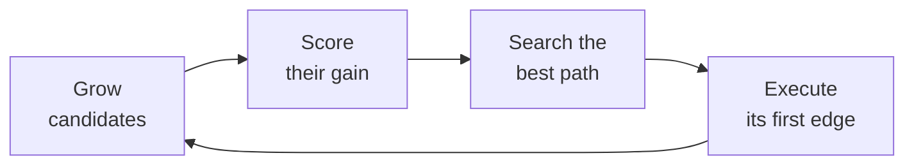

# Open Apero

[](https://github.com/OpenApero/openapero/actions)
[](https://openapero.github.io/openapero/)
[](LICENSE)

<!-- overview-start: docs/index.md shows the text up to overview-end -->
**Open Apero** (Open Active PErception Library for RObotics) is a C++17 library for **active
perception** in mobile robotics: a robot decides where to move and what to sense to gather the
observations its task needs, such as unexplored volume, unseen surface or target points.

Each planning cycle grows a graph of candidate viewpoints and scores each by its **gain**, what it
would observe in the current map. Among the paths that start at the robot, the planner seeks the one
with the most gain *g(p)* whose **cost** *c(p)*, such as trajectory time, fits the budget *C*:

```math
p^{*} = \arg\max_{p \in \mathcal{P}} \; g(p) \quad \text{subject to} \quad c(p) \le C
```

The robot executes the first edge of *p\**, and the planner plans again from where it arrives:



It is the code release of *An Efficient Beam Search Algorithm for Active Perception in Mobile
Robotics* (Qu et al., IJRR 2026; [project page](https://efficient-beam-search.github.io/)): the
paper's beam-search planners, its baselines except the external FUEL planner, its graph benchmark
and its simulated experiments.

- **Planners**: beam searches NBS and DBS, shortest-path tree search (SPT) and TSP on a random annulus
  graph (RRAG); tree baselines RRT and RRT\*
- **Tasks**: volumetric exploration, surface reconstruction and point collection (`task:=`)
- **Plugins for every role**: map, generator, evaluator, path planner, sensor model, robot model,
  cost computer, backtracker and layer, each selected by its YAML `type:`
- **ROS Noetic node** for any robot, on a [Voxblox](https://github.com/ethz-asl/voxblox) map, and a
  **Habitat-sim** setup that renders the paper's HSSD scenes

**Status:** 1.0.0, research code. Ubuntu 20.04 with ROS Noetic, or Docker on any other x86_64 Linux host; no
ROS 2 port.
<!-- overview-end -->

## Quick Start

The graph benchmark needs no simulator and no dataset. With Docker (BuildKit, the default since
Docker 23.0; the build takes about 5 minutes and 5.0 GB):

```bash
git clone --recursive https://github.com/OpenApero/openapero.git open_apero
cd open_apero
docker build -f docker/Dockerfile -t open_apero .
docker/run.sh -- roslaunch open_apero_graph_benchmark run_benchmark.launch \
  graph_type:=op_5m_25x25_clustered_gain_0to100_cost_50 replan_type:=everystep objective:=expected_gain
```

It runs NBS, DBS, SPT and TSP on five graph instances (60 runs, under a minute) and writes results
that match the paper's to `~/open_apero_data/graph_benchmark/`. The red `REQUIRED process ... has
died!` banner at the end is the normal exit. [Getting Started](docs/getting-started.md) continues
with a simulated experiment.

## Planners

`planner:=` selects one of six configurations ([Path Planners](docs/modules/path-planners.md)):

| `planner:=` | Search | Use it as |
|---|---|---|
| `nbs` | node-wise beam search on RRAG | the default: best mean result over the paper's three tasks |
| `dbs` | depth-wise beam search on RRAG | beam-search comparison |
| `spt` | shortest-path tree search on RRAG | the cheapest graph search |
| `tsp` | TSP (OR-Tools) on RRAG | coverage baseline; the slowest |
| `rrt` | best node of an RRT tree (the paper's RRAT) | sampling-tree baseline |
| `rrtstar` | best node of an RRT\* tree (the paper's RRAT\*) | sampling-tree baseline |

## Documentation

<https://openapero.github.io/openapero/>, built from [`docs/`](docs/):
[Installation](docs/installation.md), [Getting Started](docs/getting-started.md),
[How Open Apero Works](docs/concepts.md), [Modules](docs/modules/index.md),
[Integrating a Robot](docs/integrating-a-robot.md), [Extending](docs/extending.md),
[Reproducing the Paper](docs/paper.md), [Parameter Reference](docs/parameters.md) and
[FAQ](docs/faq.md). To contribute, see [CONTRIBUTING.md](CONTRIBUTING.md).

## Citation

```bibtex
@article{qu2026efficient,
  title={An Efficient Beam Search Algorithm for Active Perception in Mobile Robotics},
  author={Qu, Kaixian and Wang, Han and Klemm, Victor and Cadena, Cesar and Hutter, Marco},
  journal={The International Journal of Robotics Research},
  year={2026},
  doi={10.1177/02783649261455911},
  note={Project page: \url{https://efficient-beam-search.github.io/}}
}
```

## License

BSD 3-Clause ([LICENSE](LICENSE)), except the runner figure in
[`open_apero_ros/meshes/`](open_apero_ros/meshes/README.md) (CC BY 4.0) and the vendored headers in
`open_apero_core/include/open_apero_core/third_party/` (nanoflann: BSD 2-Clause; tinycolormap: MIT,
with a Google Apache 2.0 colormap table); see [Citation, License and Acknowledgments](docs/about.md).

## Acknowledgments

Open Apero started as a fork of [mav_active_3d_planning](https://github.com/ethz-asl/mav_active_3d_planning),
the original tree-based active 3D planning library, and has since been substantially rewritten. It
uses [Voxblox](https://github.com/ethz-asl/voxblox), [OMPL](https://ompl.kavrakilab.org/), Google's
[OR-Tools](https://developers.google.com/optimization) and Meta AI's [Habitat](https://aihabitat.org/).
