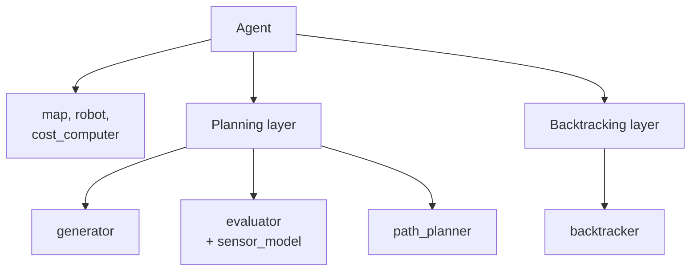
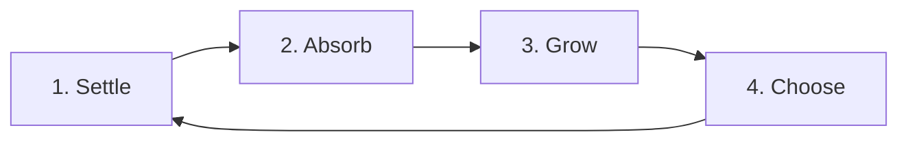

# How Open Apero Works

Open Apero's design on one page: the problem it solves, its vocabulary, who owns what, one planning cycle and how a
YAML file becomes a running planner. The [module pages](modules/index.md) then take each part in turn.

## The Problem

Open Apero plans for active perception: given a robot, a map and a measure of information gain, it repeatedly
chooses where to move so that the robot gathers the most useful observations within a cost budget
([the formulation](index.md)). It works in a receding horizon: each cycle it grows a graph of candidate viewpoints
around the robot, estimates each one's gain by simulating the sensor in the current map, prices each move (such as
in seconds of trajectory time), picks the best path by a selection objective
([Path Planners and Objectives](modules/path-planners.md)), executes only its first edge and plans again.

## Glossary

| Term | Meaning |
|------|---------|
| node | A candidate viewpoint: a `RobotState` (base pose and sensor pose) the robot could move to. |
| node cluster | The nodes that share one sensor position, one per orientation. |
| edge | A traversable trajectory between two nodes, priced by the agent's cost computer. |
| path | A chain of edges starting at the robot's node. Only its first edge is executed. |
| step | The edge a layer offers in one cycle, with its start and target node. |
| gain | What a node is expected to observe; a sum of gain anchors (`GainAnchor`). See [Evaluators](modules/evaluators.md). |
| frontier node | A node that looks into enough unexplored space; `expected_gain` and `table_gain` extrapolate a path ending there over the remaining budget. |
| episode | One run from a start state until the budget (`cost_budget`) is spent, a goal node is reached, no layer offers a step, or the platform stops it. |

## Who Owns What



The agent owns the map, the robot model and the cost computer, which every layer and plugin reaches through
`AgentInterface`; one cost computer prices every edge, so one budget covers graph planning and recovery alike. The
agent builds one layer per key of the `layers` dictionary, and each layer owns its plugins and its own candidates.
Every role except the agent is a plugin:

| Role | Responsibility | Registered types | Module page |
|------|----------------|------------------|-------------|
| `Map` | Occupancy, distance field, integrated frames | `VoxbloxMap` (`open_apero_voxblox`) | [Maps](modules/maps.md) |
| `RobotModel` | Kinematic limits, traversability, orientation sampling, steering | `SimpleRobot`, `SimpleFallbackRobot` | [Robot Models](modules/robot-models.md) |
| `CostComputer` | Edge cost, one per agent | `IdentityCost`, `TrajectoryLength`, `TrajectoryTime` | [Robot Models](modules/robot-models.md#cost-computers) |
| `Layer` | One planning behavior with its own candidates | `PlanningLayer`, `BacktrackingLayer` | [Layers](modules/layers.md) |
| `GraphGenerator` | Candidate nodes and the edges between them | `RRAG`, `RRT`, `RRTStar` | [Generators](modules/generators.md) |
| `Evaluator` | Gain and frontier flag of a candidate | `NaiveEvaluator`, `SurfaceFrontierEvaluator`, `VoxelWeightEvaluator`, `SimpleYawPlanningEvaluator`, `PointsEvaluator` (`open_apero_ros`) | [Evaluators](modules/evaluators.md) |
| `SensorModel` | Simulated view from a pose | `SimpleRayCaster`, `IterativeRayCaster`, `IterativeRayCasterLidar` | [Evaluators](modules/evaluators.md#sensor-models) |
| `PathPlanner` | Next path over the evaluated graph | `GraphNodeWiseBeamSearch`, `GraphDepthWiseBeamSearch`, `GraphShortestPathTreeSearch`, `GraphTspSearch`, `TreeBestValue`, `NoOpPathPlanner` | [Path Planners](modules/path-planners.md) |
| `Backtracker` | Recovery trajectory | `RotateInPlace`, `Reverse`, `RotateReverse` | [Robot Models](modules/robot-models.md#backtrackers) |

The paper calls the path planner the *selector*, and the generators `RRT` and `RRTStar` RRAT and RRAT*.

## One Planning Cycle



Each call of `Agent::loopIteration()` returns at once until the robot has settled, then finishes the cycle;
[Agent and Execution](modules/agent.md) has the details:

1. **Settle.** The sensor pose must be within `target_position_threshold` and `target_angle_threshold` of the
   dispatched edge's target and, with `wait_for_map_updated` (shipped `true`), the map must have integrated a frame
   there.
2. **Absorb.** The executed edge goes into `HistoryData`, every layer takes the reached state (`PlanningLayer`
   moves its start node) and the edge's cost is charged to the budget. A spent budget or a goal node ends the episode.
3. **Grow.** The robot model and every layer update against the new map, then each layer adds candidates
   (`PlanningLayer` runs `max_expansions` rounds of sample, connect, evaluate and price).
4. **Choose.** The agent asks the layers for a step in descending priority, and the first offer is sent to the
   robot; no offer ends the episode. `PlanningLayer` sits at `0`, `BacktrackingLayer` at `-1000`, promoted to
   `1000` during its initial sweep or while the robot stands in untraversable space ([Layers](modules/layers.md)).

## From YAML to a Running Planner

Each concrete class registers itself with the `PluginRegistry` under a name, and the YAML block of its role selects
it with `type:`. Swapping a planner, a gain measure or a robot model is therefore a configuration change; adding one
is a class, a registration line and a build entry ([Extending Open Apero](extending.md)). The block's other scalar
keys are the plugin's parameters, a nested block is a child plugin named after its role, and a `<role>_args` key
points that child at another namespace instead:

```yaml
# abridged from config/planners/nbs.yaml
layers:
  planning:                            # the layer's instanceName()
    type: "PlanningLayer"              # selects the class
    max_expansions: 50                 # a parameter
    generator:                         # a child plugin
      type: "RRAG"
    evaluator_args: "/task_evaluator"  # the task's evaluator, shared by every planner
```

A plugin warns about keys it did not read (`strict_params: true` stops the start instead). See
[How Parameters Are Read](parameters.md#how-parameters-are-read) and
[Configuration Files](modules/ros.md#configuration-files).

## Where Things Live

In the ROS-free core, `open_apero_core`, each role's plugins sit in `plugin/<role>/`, the loop in `agent/`, the
shared types in `graph/`, `state/`, `geometry/` and `gain/`, and the run outputs in `logging/`. Around it sit
`open_apero_voxblox` (map), `open_apero_ros` (node, launch files, configs), `open_apero_msgs` and
`open_apero_ros_bridge` (messages), `open_apero_habitat` and `open_apero_controllers` (simulation),
`open_apero_analysis` (run loading) and `open_apero_graph_benchmark` (offline benchmark).
