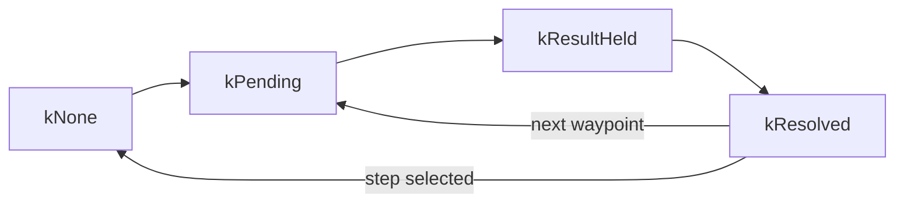

# Agent and Execution

How the `Agent` runs an episode: the loop, the settle gate, the command phases a robot driver sees, how an episode
ends, random seeding and the episode's history. Its keys are under [`Agent` Keys](../parameters.md#agent-keys) and
[`RosAgent`](../parameters.md#rosagent) in the parameter reference, its classes on the
[Agent API page](../api/agent.md).

## The Loop

The platform's loop (`Agent::planningLoop()`, or `RosAgent`'s) calls `Agent::loopIteration()` over and over. A call
returns at once until the [settle gate](#the-settle-gate) passes on the edge's last waypoint (`executeTrajectory()`
sends the next waypoint, if any), then runs the rest of the [planning cycle](../concepts.md#one-planning-cycle):

1. The executed edge goes into `HistoryData`, and every layer's `onStateReached()` receives the reached state, the
   edge and its target node. The edge's cost is charged to the budget (`cost_budget`, shipped `600`); a spent budget
   or a terminating target node ends the episode.
2. `RobotModel::update()`, then every layer's `update()` and, if `Agent::readyToExpand()` (default `true`), every
   layer's `expand()`.
3. `requestNextTrajectory()` asks the layers in descending `getPriority()`, takes the first step offered, writes the
   cycle's `performance_log.csv` row (with `log_performance`) and hands the step's first edge to `sendMovement()`.
   Equal runtime priorities or a malformed step throw `std::runtime_error`.

`sendMovement(EdgeCursor*)` is the one hook through which every platform moves. It sends the edge waypoint by
waypoint (`EdgeCursor::advance()`) or as one command (`EdgeCursor::finish()`, as `RosAgent` and `BenchmarkAgent`
do) and returns whether a command was published. The platform reports the outcome with
`setCurrentState(state, StateUpdateKind::kCommandResult)`; the agent zeroes the sensor roll of every state.

## The Settle Gate

After `sendMovement()` the agent replans only when the reported sensor pose is within `target_position_threshold`
and `target_angle_threshold` (shipped `0.10` m, `0.20` rad) of the waypoint and, with `wait_for_map_updated`
(shipped `true`), the map reports a frame integrated at that pose. The frame wait applies only after a command was
actually sent.

Once a wait has lasted a second, the agent logs a `[settle]` warning naming what is missing, then at most once a second:
the command's state, the pose (with its errors) or the map frame. At each replan, for a map that reports its frames,
such as `VoxbloxMap`, it also compares the commands dispatched with the frames mapped (the `CommandsDispatched` and
`FramesMapped` columns) and logs a `[frame ledger]` error when fewer frames arrived.

## Command Phases

`Agent::CommandPhase` tracks where the command sent this cycle stands:

In `kNone` no command was sent, so no frame can come and the map-frame wait is skipped. Only in `kResultHeld` is the
held state the command's own result; a pose observation (`kPoseObservation`) never resolves `kPending`, and any later
state ends `kResultHeld`. A vetoed `sendMovement()` leaves no command pending. With `RosAgent`'s `use_tf: false`
(shipped) every `robot_state` message is the preceding command's result; with `use_tf: true`, TF only updates the pose
and the robot driver publishes a `CommandResult` on `command/result`. [Integrating a Robot](../integrating-a-robot.md)
has the topics.

## Ending an Episode

`episode_summary.yaml` ([Run Output and Analysis](run-output.md)) records how the episode ended as `end_reason`:

| `end_reason` | `Agent::EpisodeEnd` | When |
|--------------|---------------------|------|
| `budget_exhausted` | `kBudgetExhausted` | The executed edge's cost used up the budget; that edge is counted |
| `goal_reached` | `kGoalReached` | The executed edge's target node was flagged `is_terminating` (only by a custom layer or evaluator, such as the `ReturnHomeLayer` of [Extending Open Apero](../extending.md#adding-a-layer)) |
| `no_step` | `kNoStep` | No layer offered a step |
| `stopped` | `kStopped` | The platform stopped the planner (`toggle_running(false)` in `open_apero_node`, or its shutdown during a started episode) |

After any of the first three, `open_apero_node` exits unless `exit_on_episode_end` is `false`, in which case
`~reset` starts the next episode; after `stopped`, `toggle_running(true)` resumes. Plugins are built once:
`resetEpisode()` clears the per-episode state of the map, the robot model, the cost computer and every layer.

## Random Seeding

`random_seed` (default `-1`) seeds every stochastic plugin: `SimpleRobot`'s sampling, through which the generators
sample, the random fallback step of every searching path planner and the yaw choice of `SimpleYawPlanningEvaluator`.
Each draws from a `SeededRng` seeded from the seed and the plugin's namespace and reseeded at every episode start; `-1`
seeds from `std::random_device`. With a seed ≥ 0, `SimpleFallbackRobot` also seeds OMPL's process-global generator, once
at setup. Anything bounded by wall time, such as that OMPL fallback (`ompl_planning_time`), can still make runs differ.

## History and Observed Viewpoints

`HistoryData` records the executed edges, drawn as the past trajectory, and the observed viewpoints
(`HistoryData::getObservedViewpoints()`): every sensor pose the map integrated a frame from. `isObserved()` tells
whether a stored viewpoint lies within `observed_viewpoint_position_threshold` and
`observed_viewpoint_angle_threshold` of a pose, and `getViewpointIndicesNear()` lists the viewpoints near a
position. Both thresholds `0.0` (the default) disable these queries; no shipped plugin uses them
([Extension Hooks](extension-hooks.md)).
