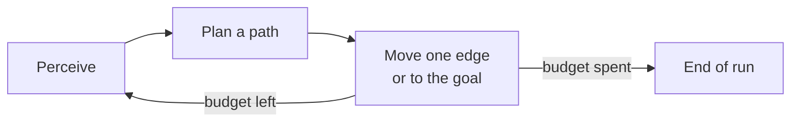
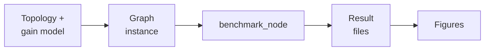

# Graph Benchmark

The offline benchmark of the graph path planners: what it measures, how a run proceeds, the datasets, the result
files and the tools. The node's parameters, topics and file formats are in the
[`open_apero_graph_benchmark` README](https://github.com/OpenApero/openapero/blob/main/open_apero_graph_benchmark/README.md),
the tools in the
[`scripts` README](https://github.com/OpenApero/openapero/blob/main/open_apero_graph_benchmark/scripts/README.md) (every
flag in each tool's `--help`), and
the verification procedure in [Reproducing the Paper](../paper.md#graph-benchmark).

## What It Measures

`open_apero_graph_benchmark` runs the four graph path planners of `open_apero_core` (NBS, DBS, SPT and TSP) on
synthetic graphs with a gain on every node and a cost on every edge, with no simulator and no map. The perception
model decides what the planner sees: a priori (`ap_` datasets) the whole graph from the start; online perception
(`op_<R>m_` datasets) only the nodes within radius R of the nodes reached so far. The paper's graph-benchmark results
come from it.

`benchmark_node` stands in for the robot with `BenchmarkAgent`, which stubs out movement and holds the remaining cost
budget the planners score against; the planners are built directly and configured through `setupRaw()`.

## One Run

One run per graph, objective, replanning mode, algorithm and parameter. It starts at node 0; to perceive,
`GraphManager` adds the nodes in range and prunes those unreachable from the current node. While the cost is below
`cost_budget`, the node calls `planPath()`, follows the plan's edges, collects and clears the gain of each node reached
and re-perceives from it. `replan_type` sets how much of a plan is committed: `everystep` one edge, `goal` the whole
path, `none` one plan and then stop. A run also ends when the planner has no path or the next edge exceeds the budget;
the console reports a block's end reasons as `reasons=` when they differ (see the README).

`benchmark_node` sweeps every graph instance of a dataset folder, every objective and replanning mode, the beam widths
of DBS and NBS and the top-node percentages of SPT and TSP: with the launch defaults 5 graphs × 4 objectives × 3 modes
× 12 runs, 720 result files. It validates every input before it writes the first result file. The node is `required`,
so roslaunch exits with the sweep; the red `REQUIRED process … has died!` banner that follows is the normal end.

## Datasets and Result Files

`data/` holds eight datasets named `<prefix><W>x<H>_<gain pattern>_gain_0to100_cost_<budget>`: a priori or online
perception within 5 m, 25×25 or 50×50 graphs, clustered or scattered gains, and a cost budget of 50 or 100. Each holds
five instances `graph_0` … `graph_4/graph.txt` and a `reference.json` that condenses the paper's result files. The
launch file reads the perception radius and the budget from the dataset name. `generate_graph_instance_node` samples a
new instance from a topology and a gain model, below `<data root>/graph_benchmark/generated/`.

Each run writes one result file below `<data root>/graph_benchmark/<dataset>/graph_N/<replan>/<objective>/`, named
`nbs_<B>.txt`, `dbs_<B>.txt`, `spt_<α>.txt` or `tsp_<α>.txt`, with one row per sample: cumulative gain, cumulative cost,
cumulative planning time, the current node and the size of the perceived graph. The data root is
`$OPEN_APERO_DATA_ROOT`, else `~/open_apero_data`; nothing but `reference.json` is written into `data/`.

## Tools

The Python tools in `scripts/` generate graph inputs (`generate_random_graph_topology.py`,
`generate_clustered_gain_model.py`), check a sweep against the paper (`verify_benchmark_results.py`,
`benchmark_reference.py`, `compare_result_trees.py`) and render the figures (`plot_final_gain_ranges.py`,
`plot_computation_time_ranges.py`, `render_graph.py`). Every tool but `compare_result_trees.py` builds on
`open_apero_analysis`.

## Ties and Reproducibility

When no perceived node has positive gain, every candidate scores 0; this happens in graphs 0, 1 and 3 of
`op_5m_25x25_clustered_*` and in all five of `op_5m_50x50_clustered_*`, whose nearest gain lies beyond the 5 m radius of
the start. `PathPlanner::updateBest` breaks exact ties: under `expected_gain` and `table_gain` a candidate ending at the
frontier wins; otherwise ratio, then gain, then lower cost. Candidates equal in all of these fall back to enumeration
order, which depends on hash buckets rather than the graph file, so the same graph file yields the same selection only
on the same toolchain; the tested one is the Docker image's. Before trusting a mismatch, rebuild `open_apero_core` and
`open_apero_graph_benchmark`: a `benchmark_node` older than `libopen_apero_core.so` can disagree through a stale vtable.
