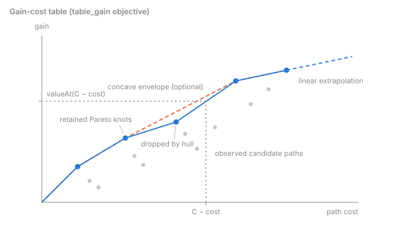

# Path Planners and Objectives

How the planning layer selects a path over its evaluated graph: the shipped planners, the selection objectives,
ties and the fallback step, and the beam searches' complexity. The classes are under
[Path Planner](../api/plugin-interfaces.md#path-planner) and
[built-in path planners](../api/builtin-plugins.md#path-planners), the keys under
[Path Planners](../parameters.md#path-planners) in the parameter reference.

## The Shipped Planners

A planner is a generator plus a path planner, set in `open_apero_ros/config/planners/<planner>.yaml` and selected
with `planner:=`. All six use the `expected_gain` objective and the task's
[evaluator](evaluators.md#the-evaluator-of-each-task):

| `planner:=` | Generator | Path planner | Selection |
|-------------|-----------|--------------|-----------|
| `nbs` | `RRAG` | `GraphNodeWiseBeamSearch`, `beam_width: 1`, `beam_depth: 100` | Grows paths edge by edge, keeping the `beam_width` best-ratio paths into each end node |
| `dbs` | `RRAG` | `GraphDepthWiseBeamSearch`, `beam_width: 100`, `beam_depth: 100` | As `nbs`, but keeps the `beam_width` best-ratio paths per depth |
| `spt` | `RRAG` | `GraphShortestPathTreeSearch`, `top_node_percentage: 1.0` | Shortest path to each candidate node |
| `tsp` | `RRAG` | `GraphTspSearch`, `top_node_percentage: 0.5` | A low-cost open tour through the candidate nodes (OR-Tools); ignores the objective and the budget |
| `rrt` | `RRT` | `TreeBestValue` | Best path from the root to any tree node; `SimpleYawPlanningEvaluator` picks each node's yaw |
| `rrtstar` | `RRTStar` | `TreeBestValue` | As `rrt`, on a tree rewired for lower cost |

`nbs` has the best mean normalized gain over the paper's three tasks ([Reproducing the
Paper](../paper.md#active-perception-experiments)). SPT and TSP route to *candidate nodes*: the nodes in the top
`top_node_percentage` of the graph's gain range, plus every frontier node. TSP scales the shortest-path costs by
`cost_scale` and truncates them to integers for OR-Tools (default `1.0`: whole seconds). Every path
planner but TSP drops paths over the remaining budget. With `check_previous_path` (default `true`, shipped `false`), NBS
and DBS also score the rest of the previous path. `TreeBestValue` works only with the tree generators; `NoOpPathPlanner`
returns no path, for layers that select their own step.

## Selection Objectives

With `C` the agent's remaining cost budget, a path with total `gain`, `cost` and `ratio = gain / cost` scores under
the required `path_planner.objective`:

| `objective` | Score |
|-------------|-------|
| `path_gain` | `gain` |
| `path_ratio` | `ratio` |
| `expected_gain` | `ratio × C` if the path ends at a frontier node, else `gain` |
| `table_gain` | `gain + table.valueAt(max(0, C − cost))` if the path ends at a frontier node, else `gain` |

`table_gain` replaces the extrapolation of `expected_gain` with the **gain-cost table** (`GainCostTable`): every
candidate path scored under `table_gain` adds a `(cost, gain)` knot, a knot is dropped when another at no more cost
has at least its gain, and with `concave_envelope` (default `true`) the rest are reduced to their upper concave
hull. The table interpolates linearly from `(0,0)`, extrapolates along its last segment, and is cleared each episode.
Candidates are scored against the table built so far, so `table_gain` depends on the search order.

## Ties and the Fallback Step

Exact ties go to a frontier end under `expected_gain` and `table_gain`, then to the higher ratio, the higher gain
and the lower cost. The beams of `nbs` and `dbs` are ranked by ratio, gain and lower cost whatever the objective; the
objective only picks the answer. When the search keeps no path, for example because every path exceeds the remaining
budget, the path planner returns a one-edge step to a random neighbor so the robot keeps moving.

## Beam Search Complexity

As shipped (`check_previous_path: false`, no gain suppression), DBS and NBS run Algs. 1 and 2 of the paper unchanged:
the same expansions in the same order, the same preference operator and the same selection criteria. Only the
bookkeeping of a path differs. In the paper, extending a path copies it and scans it for a revisit, O(D) each time. Here
a path is its cost, gain and last step, and paths share their common prefix as a chain of steps, so an extension adds
one step in O(1). When a path is expanded, its steps are walked once, O(D), marking on the graph the nodes it visited;
each of its extensions then checks a mark in O(1). The marks live on the graph, so one search runs on a graph at a time.

**In theory.** In the notation of the paper's Table 1 (graph G = (V, E), beam width B, depth D):

| Alg. | Time, paper | Time, this release | Space, paper | Space, this release |
|---|---|---|---|---|
| DBS | O(\|V\| D B (D + log B)) | O(D B (D + \|V\| log B)) | O(D B) | O(\|V\| D B) |
| NBS | O(\|E\| D B (D + log B)) | O(D B (\|V\| D + \|E\| log B)) | O(\|V\| D B) | O(\|E\| D B) |

Time: the O(D) term moves from every extension to every expanded path, so per path it shrinks by the branching factor,
\|V\| for DBS and \|E\| / \|V\| for NBS. Space: a step is kept until the search returns, because other paths may
share it, so the bound is one step per extension that entered a beam or became the best path, above the paper's
live-beam bound. With `is_gain_correlated`, where a node holds A gain anchors, the walk costs O(D A) and a gain check
O(A).

**In practice.** About one extension in six keeps its step, and the shared steps take less memory than the copies
did. On a synthetic graph of 65 positions × 32 orientations with four shared anchors each (NBS, B = 1, D = 200), one
search takes 0.33 s and 13.6 MB instead of 4.0 s and 40.9 MB. The gain grows with path length.

**Graph benchmark.** The DBS, NBS and SPT result files of all eight datasets match the paper's file by file: the same
paths and the same gains. Their cost budgets stop paths at about 15 edges, long before D, so the planning time is
within 3 % of the implementation behind the paper on six of the eight datasets.
