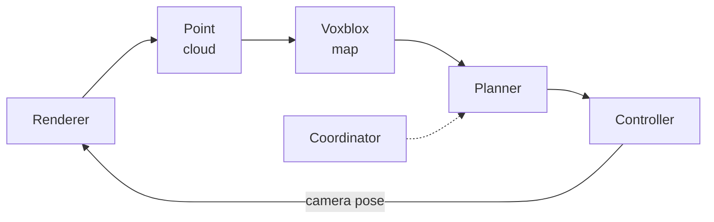

# open_apero_ros

ROS integration of Open Apero ([ROS Node, Launch Files and Messages](../docs/modules/ros.md)): `open_apero_node`
runs the planning `Agent` of [`open_apero_core`](../open_apero_core/README.md) under ROS, with helper nodes, the
`PointsEvaluator` plugin, and the launch files, configurations, scenes and [scripts](scripts/README.md) of the
simulated experiments.

```bash
conda activate habitat               # Habitat-sim, see docs/installation.md
source devel/setup.bash              # from the workspace root
source src/open_apero/datasets.env   # HSSD_DATA_ROOT, see datasets.env.example at the repository root
roslaunch open_apero_ros run_experiment_sim.launch planner:=nbs task:=recon scene_id:=102816852 cost_budget:=300
```

The run writes `$HOME/open_apero_data/HSSD/102816852/nbs/<YYYYmmdd_HHMMSS>/` ([Run Output and
Analysis](../docs/modules/run-output.md)) and ends when the budget is spent, when no layer offers a step, after
`time_limit` minutes, or on a message on `/open_apero/collision`.

<!-- pipeline-start: docs/modules/ros.md shows the diagram up to pipeline-end -->

<!-- pipeline-end -->

The boxes are `habitat_renderer_node` ([`open_apero_habitat`](../open_apero_habitat/README.md)),
`rgbd_to_pointcloud_node`, `voxblox_node` (`esdf_server` of the [voxblox fork](https://github.com/OpenApero/voxblox)),
`open_apero_node`, `dummy_controller_node` ([`open_apero_controllers`](../open_apero_controllers/README.md)) and
`mission_coordinator_node`; the nodes of this package are below.

## Launch files

### `run_experiment_sim.launch`

One simulated run: the nodes above and, per `rviz`, RViz with `rviz/experiment.rviz`; it ends when the coordinator
or the planner exits. Load the `config/` files only through a launch file, as a bare `rosparam load` keeps their
`$(env …)` and `$(find …)` literal ([Configuration Files](../docs/modules/ros.md#configuration-files)).

`rviz/experiment.rviz` groups its displays into Map, Agent (base and camera axes, the runner, the next view's
frustum), Task (the collectible rings) and Plan (the trajectories), shown, and Layers, Sensor and Debug, hidden; it
looks down on the agent, and its Views panel holds a zoomed-out "Whole map" and a 3D "Follow" view.

| Argument | Default | Meaning |
|---|---|---|
| `planner` | `nbs` | Loads `config/planners/<planner>.yaml` after `_common.yaml`; names the run's planner folder |
| `planner_config` | `config/planners/<planner>.yaml` | Planner file to load instead; `planner` still names the folder |
| `task` | empty | `explore` (volumetric exploration, `NaiveEvaluator`), `recon` (surface reconstruction, `SurfaceFrontierEvaluator`) or `points` (point collection, `PointsEvaluator`): `config/tasks/<task>.yaml` over `_common.yaml` into `/task_evaluator`, cleared first; empty keeps `_common.yaml` |
| `cost_budget` | empty | Budget [s of trajectory time]; empty keeps `config/planners/_common.yaml`'s 600 |
| `scene_dataset`, `scene_id` | `HSSD`, `102816036` | Scene file `config/scenes/<scene_dataset>/<scene_id>.yaml` (after `_common.yaml`); the Habitat scene |
| `data_root` | `$OPEN_APERO_DATA_ROOT`, else `$HOME/open_apero_data` | Root of the run directories |
| `time_limit` | `10` | Minutes from planner start until the coordinator stops the run; 0 disables it |
| `speedup_factor` | `5` | `dummy_controller_node` runs trajectories this many times faster than real time |
| `ray_length` | `3.0` | Camera max depth [m]: Habitat's `max_depth`, voxblox `max_ray_length_m` and the task evaluator's `sensor_model/ray_length` |
| `observation_boundary` | `planar` | Where the camera's view ends, for voxblox and the task evaluator's `sensor_model`: `planar` (camera depth `ray_length`, a depth camera's) or `spherical` (distance `ray_length`, the paper's model) |
| `far_depth_sentinel` | `10.0` | Depth Habitat writes beyond `ray_length` [m]; must exceed it |
| `voxel_size`, `voxels_per_side`, `truncation_distance` | `0.1`, `8`, `0.2` | Voxel size [m], voxels per block side (voxblox and the planner's map), TSDF truncation [m] |
| `map_frame`, `base_frame`, `camera_frame`, `camera_optical_frame` | `world`, `base`, `camera_frame`, `camera_optical_frame` | Frames of every node |
| `log_level` | `info` | Planner console filter: `debug`, `info`, `warn`, `error`, `fatal` |
| `verbose_planner`, `verbose_voxblox` | `true`, `false` | `verbose` of the planner and of `voxblox_node` |
| `visualize` | `true` | Planner markers, RViz, and the ring visualizer with `task:=points` |
| `rviz` | `visualize` | Start RViz; `false` keeps the markers for an RViz started elsewhere, such as `docker/rviz_host.sh` on the host of a Docker run |
| `log_data` | `true` | The planner's `log_performance`: write `performance_log.csv` |
| `num_maps_to_save` | `0` | Map snapshots written into the run directory |
| `record_rosbag` | `false` | Record `/tf`, `/tf_static`, `/voxblox_node/mesh`, `/command/trajectory`, `/next_movement`, `/trajectory_visualization`, `/collectible_point_markers` and `/status_overlay` to `<data_root>/<scene_dataset>/<scene_id>/<planner>/open_apero_bag_<stamp>.bag` |

The `recon` and `points` settings are the paper's; `task:=points` also loads `config/tasks/_points_planning.yaml`
into `layers/planning` (edges 1.0-2.0 m, correlated gain).

### `replay_rosbag.launch`

Replays a `record_rosbag:=true` bag into RViz with the experiment's displays, on the bag's clock:
`roslaunch open_apero_ros replay_rosbag.launch bag_path:=<absolute path>`. Further arguments: `rate`, the playback
rate factor (`100`), and `start`, the seconds into the bag to start at (`0.0`).

## Scene files

`config/scenes/HSSD/_common.yaml` holds the Habitat dataset config, the bounding volumes from the stage meshes with a
0.2 m margin, and the start height 1.0 m; `<scene_id>.yaml` adds the stage and the start position.

| File | Stage `scene_id` | Start (x, y) [m] | Scene | [Paper](../docs/paper.md) set, budget |
|---|---|---|---|---|
| `102344049.yaml` | `102344049` | (4, 4) | Medium apartment, completely indoor | large, 600 s |
| `102344280.yaml` | `102344280` | (4, 4) | Medium apartment, completely indoor | large, 600 s |
| `102815835.yaml` | `102815835` | (4, 4) | Small apartment, completely indoor, perfect rectangle | small, 300 s |
| `102816009.yaml` | `102816009` | (4, 4) | Large apartment with a balcony and many rooms | large, 600 s |
| `102816036.yaml` | `102816036` | (10, 10) | Large apartment; the launch default | large, 600 s |
| `102816216.yaml` | `102816216` | (-10, 10) | Tiny apartment | small, 300 s |
| `102816852.yaml` | `102816852` | (4, 4) | Small apartment, perfect rectangle | small, 300 s |
| `103997445.yaml` | `103997445_171030492` | (4, 4) | Medium apartment, completely indoor, almost rectangular | large, 600 s |
| `103997562.yaml` | `103997562_171030642` | (4, 4) | Medium apartment, completely indoor | not used |

## open_apero_node

Runs in the global namespace: relative names resolve to `/<name>`, private ones to `/open_apero_node/<name>`. Every
published topic but `command/trajectory` and `next_movement` needs `visualize: true`.

| Kind | Name | Type | Description |
|---|---|---|---|
| Published | `command/trajectory` | `open_apero_msgs/RobotTrajectory` | The trajectory to execute, one per command |
| Published | `next_movement` | `nav_msgs/Path` | The same trajectory as sensor poses |
| Published | `trajectory_visualization` | `visualization_msgs/MarkerArray` | Past and planned trajectories |
| Published | `status_overlay` | `jsk_rviz_plugins/OverlayText` | Active layer, traversed distance, elapsed trajectory time |
| Published | `layer_visualization/<layer>`, `path_visualization/<layer>`, `layer_visualization/active`, `path_visualization/active` | `visualization_msgs/MarkerArray` | Graph and selected path of each layer; the `active` topics repeat those of this cycle's winning layer |
| Published | `map_visualization`, `robot_visualization` | `visualization_msgs/MarkerArray` | Map and robot markers |
| Published | `collectible_points` | `open_apero_msgs/CollectiblePointArray` | Point states; `PointsEvaluator` only |
| Subscribed | `robot_state` | `open_apero_msgs/RobotState` | `use_tf: false`: the result of the latest command |
| Subscribed | `command/result` | `open_apero_msgs/CommandResult` | `use_tf: true`, with the pose from TF at 20 Hz: completes the command with the same `command_sequence`, no timeout |
| Subscribed | `~tsdf_map_in`, `~esdf_map_in` | `voxblox_msgs/Layer` | Map layers ([`open_apero_voxblox`](../open_apero_voxblox/README.md#ros-interface)) |
| Service | `~toggle_running` | `std_srvs/SetBool` | `true`: start the episode in `~run_dir`, or resume it; `false`: stop and write `episode_summary.yaml`, which a shutdown (Ctrl+C) during a started episode also writes |
| Service | `~reset` | `std_srvs/Empty` | New episode from the current pose; clears the markers. It writes into the same run directory: its rows continue `performance_log.csv` from `CycleIndex` 0, and its end replaces `episode_summary.yaml` |
| Service | `~get_wall_time` | `std_srvs/SetBool` | Wall-clock seconds since the previous call, in `message` |
| Calls | `/rviz/screenshot` | `jsk_rviz_plugins/Screenshot` | On `toggle_running(false)` and when the budget is spent, with `visualize: true`: `<run dir>/rviz_screenshot.png`; without RViz it logs a warning |
| Calls | `/voxblox_mesh_display/reset` | `std_srvs/Trigger` | By `VoxbloxMap` at each episode start, if RViz offers it |

Private parameters. The [Parameter Reference](../docs/parameters.md#agent) has the `map`, `robot`, `cost_computer`
and `layers` blocks, [`open_apero_voxblox`](../open_apero_voxblox/README.md#parameters) the map mirror's voxblox keys.
Launch: the value of `config/planners/_common.yaml` or of a launch argument; empty when the launch leaves it unset.

| Parameter | Default | Launch | Description |
|---|---|---|---|
| `use_tf` | `true` | `false` | Pose from TF and `command/result` instead of `robot_state` |
| `map_frame` | `map` | `map_frame:=` | Frame of commands, results and markers |
| `base_frame`, `camera_frame` | `base`, `camera_frame` | `base_frame:=`, `camera_frame:=` | TF base and sensor frames |
| `exit_on_episode_end` | `true` | | Exit when an episode ends by itself; `false` keeps the node alive for `~reset` |
| `run_dir` | empty | from `mission_coordinator_node` | Run directory, read at the first `toggle_running(true)` |
| `log_level` | `info` | `log_level:=` | Console filter for rosconsole and the core logging |
| `plugin_libraries` | `[libopen_apero_voxblox.so]` | | Plugin libraries loaded before the agent is built ([Extending](../docs/extending.md#in-your-own-package)) |
| `verbose`, `verbose_plugins` | `true`, `true` | `verbose_planner:=`, `true` | Per-cycle planner reports; each plugin's parameters when it is built |
| `debug_diagnostics` | `false` | | Extra settle-gate and frame-ledger diagnostics |
| `build_plugins_on_init` | `false` | `true` | Warm the layers up at construction |
| `visualize` | `true` | `visualize:=` | Markers, overlay and the end-of-run RViz screenshot |
| `color_past_trajectory_by_budget` | `false` | `true` | Color the past trajectory by spent budget |
| `log_performance` | `false` | `log_data:=` | Write `performance_log.csv` |
| `num_maps_to_save` | `0` | `num_maps_to_save:=` | Number N of map snapshots: map k (k < N) at the first replan past k/N of the budget, never the final map; an unbounded budget saves one when the episode ends or is stopped ([Run Directory](../docs/modules/run-output.md#run-directory)) |
| `cost_budget` | unbounded | `600`, `cost_budget:=` | Budget in cost-computer units; below 1e-4 is unbounded |
| `wait_for_map_updated` | `false` | `true` | Before replanning, wait for a mapped frame from the reached pose |
| `target_position_threshold`, `target_angle_threshold` | `0.1`, `0.1` | `0.10`, `0.20` | Arrival tolerance of the sensor [m, rad] |
| `observed_viewpoint_position_threshold`, `observed_viewpoint_angle_threshold` | `0.0`, `0.0` | | `HistoryData::getObservedViewpoints()` thresholds [m, rad] for custom plugins; both `0.0` disables it |
| `random_seed` | `-1` | | Seed for stochastic plugins; negative is nondeterministic |
| `strict_params` | `false` | | A key no setup reads fails startup instead of logging a warning |
| `map_args`, `robot_args`, `cost_computer_args` | `<ns>/map`, `<ns>/robot`, `<ns>/cost_computer` | | Namespaces of the map, robot model and cost computer |

## mission_coordinator_node

Creates `<runs_dir>/<YYYYmmdd_HHMMSS>/` as the planner's `run_dir`, waits for `simulation_ready` and the planner's
`toggle_running` (`std_srvs/SetBool`), starts the planner after `delay` and dumps the parameter server to
`rosparams.yaml`. On the time limit, the first `collision` message, a startup timeout or a refused start it stops the
planner (if started) and shuts down, ending the launch; it logs the time limit as a warning, the others as errors. Both
topics are `std_msgs/String`, the relative names `simulation_ready` and `collision`, which the launch remaps to
`/open_apero/<name>`; `habitat_renderer_node` publishes `simulation_ready`, and `collision` is the hook for an external
collision monitor.

| Parameter | Default | Launch | Description |
|---|---|---|---|
| `~ns_planner` | `/open_apero_node` | `/open_apero_node` | Planner namespace |
| `~runs_dir` | required | `<data_root>/<scene_dataset>/<scene_id>/<planner>` | Parent of the stamped run directory, `~` expanded |
| `~time_limit` | `0.0` | `time_limit:=` | Minutes from planner start; 0 disables it |
| `~startup_timeout` | `0.0` | `30.0` | Seconds to wait for `simulation_ready` and for the planner service; 0 waits forever |
| `~delay` | `0.0` | `3.0` | Seconds between the planner service appearing and the start call |
| `~wait_for_simulation` | `true` | | Wait for `simulation_ready`; `false` on a real robot |

## rgbd_to_pointcloud_node

Turns exactly time-synchronized `camera_info` (`sensor_msgs/CameraInfo`), `rgb_image` and 32-bit float `depth_image`
(`sensor_msgs/Image`) into the colored `point_cloud` (`sensor_msgs/PointCloud2`, XYZRGB) in the depth frame while it
has subscribers, dropping NaN and sub-1e-4 m depths; the launch remaps each topic to `/open_apero_camera/<name>`.

| Parameter | Default | Launch | Description |
|---|---|---|---|
| `~ray_min_range`, `~ray_max_range` | `0.0`, `0.0` | `0.0`, `far_depth_sentinel + 0.1` | Drop depths below and above [m]; 0 disables a bound. The launch maximum keeps the sentinel, which voxblox needs to clear free space |
| `~decimation_factor` | `1` | `3` | Use every n-th row and column; must be at least 1 |

## collectible_points_visualization_node

Display only, started with `visualize:=true` and `task:=points`: turns `collectible_points` into
`collectible_point_markers` (`visualization_msgs/MarkerArray`), a rotating ring at every observed or collected point
that shrinks away once collected, and a runner figure below `camera_frame` ([asset license](meshes/README.md)).

| Parameter | Default | Launch | Description |
|---|---|---|---|
| `~map_frame`, `~camera_frame` | `map`, `camera_frame` | `map_frame:=`, `camera_frame:=` | Frame of the rings; frame the figure follows |
| `~rotate_speed` | `0.1` | `3.14` | Ring rotation [rad/s] |
| `~publish_rate` | `30.0` | `10` | Marker rate [Hz] |
| `~shrink_duration` | `1.0` | `1.0` | Shrink time of a collected ring [s] |
| `~runner_frame_step`, `~runner_frame_max` | `2`, `32` | `2`, `32` | Animation frame increment and last frame; only the even frames up to 32 ship |

## PointsEvaluator plugin

The point-collection gain evaluator ([Evaluators](../docs/modules/evaluators.md)); it publishes `collectible_points`.
It takes the `SimulatedSensorEvaluator` keys plus `points_file`, a CSV of `x,y,z,radius,gain` rows (the shipped
`data/points_3d.csv` has 20000). A point is observed once its voxel is free, collected once an executed waypoint puts
the sensor within `radius`.

## Dependencies

`open_apero_core`, `open_apero_msgs`, `open_apero_ros_bridge`, `roscpp`, `rospy`, `std_msgs`, `std_srvs`, `sensor_msgs`,
`geometry_msgs`, `visualization_msgs`, `nav_msgs`, `tf2`, `tf2_ros`, `cv_bridge`, `message_filters`, `pcl_conversions`,
`pcl_ros`, `jsk_rviz_plugins`; at run time `open_apero_voxblox`, `voxblox_ros`, `open_apero_habitat`,
`open_apero_controllers`, `open_apero_analysis`, `rviz`, `voxblox_rviz_plugin`, `rosbag`; NumPy, Matplotlib, seaborn;
pytest and PyYAML for the tests.

## Tests

```bash
catkin build open_apero_ros --no-deps --catkin-make-args run_tests --   # from the workspace root
MPLBACKEND=Agg python3 -m pytest test   # the pytest suites alone: from the package root, workspace sourced
```

Neither needs a ROS master; [Running Tests](../CONTRIBUTING.md#running-tests) covers reading the results.
